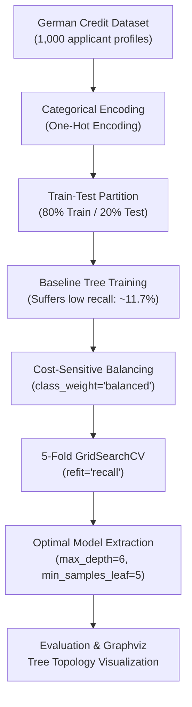

# Loan Default Risk Prediction Using Decision Trees with Class Balancing & GridSearch

[](https://www.python.org/)
[](https://scikit-learn.org/)
[](https://pandas.pydata.org/)
[](https://jupyter.org/)
[](LICENSE)

A financial credit risk assessment system implementing a **Cost-Sensitive Decision Tree Classifier** on the German Credit Dataset. The model specifically tackles severe financial asymmetric loss by balancing class weights and optimizing hyperparameters via **GridSearchCV** with a focus on maximizing **Defaulter Recall**.

---

## Table of Contents

- [Overview](#overview)
- [Key Highlights](#key-highlights)
- [Workflow Architecture](#workflow-architecture)
- [The Cost-Sensitive Credit Risk Challenge](#the-cost-sensitive-credit-risk-challenge)
- [Hyperparameter Optimization via GridSearchCV](#hyperparameter-optimization-via-gridsearchcv)
- [Performance & Metric Comparison](#performance--metric-comparison)
- [Repository Structure](#repository-structure)
- [Getting Started](#getting-started)
- [Author](#author)

---

## Overview

In commercial banking and consumer lending, the financial cost of a **False Negative** (approving a loan for a customer who subsequently defaults) is exponentially higher than that of a **False Positive** (declining a creditworthy applicant). Standard classifiers trained on unweighted data prioritize majority-class accuracy at the expense of loan default detection. 

This project demonstrates how cost-sensitive weighting (`class_weight="balanced"`) and metric-directed cross-validation tuning (`refit="recall"`) transform an unweighted decision tree (11.7% recall) into a high-utility risk engine achieving **68.33% defaulter recall**.

---

## Key Highlights

- **Addressing Asymmetric Risk**: Solved the default detection blind spot by penalizing defaulter misclassifications via inverse class frequency weighting.
- **Recall Elevation**: Boosted default detection recall from **11.67% to 68.33%**, successfully intercepting high-risk borrowers.
- **Systematic Grid Search**: Tuned tree depth and split constraints across 64 hyperparameter combinations using 5-fold cross-validation.
- **Tree Explainability**: Exported and visualized the tree architecture using Graphviz, mapping exact splitting thresholds on checking account status, loan duration, credit history, and age.
- **Dual Artifacts**: Includes both the executable Jupyter Notebook (`.ipynb`) and the complete analytical document (`.pdf`).

---

## Workflow Architecture



---

## The Cost-Sensitive Credit Risk Challenge

Standard tree algorithms minimize general Gini impurity:

$$Gini = 1 - \sum_{i=1}^{C} p_i^2$$

When non-defaulters outnumber defaulters, models achieve deceptively high accuracy by simply predicting "Non-Defaulter" for ambiguous profiles. By applying weighted Gini criterion:

$$w_j = \frac{N}{2 \times N_j}$$

the loss function penalizes default misclassifications proportionally to their class frequency.

---

## Hyperparameter Optimization via GridSearchCV

The model underwent 5-fold cross-validation exploring:
- **`max_depth`**: `[6, 8, 9, 10]`
- **`min_samples_split`**: `[2, 5, 10, 20]`
- **`min_samples_leaf`**: `[1, 2, 5, 10]`

### Best Hyperparameters Identified:
- `max_depth`: **6** (prevents leaf node overfitting)
- `min_samples_split`: **20**
- `min_samples_leaf`: **5**
- `class_weight`: **`"balanced"`**
- `random_state`: **42**

---

## Performance & Metric Comparison

### Impact of Class Weighting & Tuning

| Configuration | Test Accuracy | Defaulter Recall | Defaulter Precision | F1-Score |
| :--- | :---: | :---: | :---: | :---: |
| **Unweighted Tree (Depth 4)** | 69.50% | 11.67% | 46.67% | 0.1867 |
| **Unweighted Tree (Depth 5)** | 69.00% | 13.33% | 44.44% | 0.2051 |
| **Balanced Tree (Depth 4)** | 63.00% | 71.67% | 43.00% | 0.5375 |
| **Optimal Tuned Tree (GridSearch)** | **64.00%** | **68.33%** | **43.62%** | **0.5325** |

### Key Takeaway
While raw accuracy decreased slightly (from ~69% to 64%), **defaulter capture surged nearly 6-fold (from 11.67% to 68.33%)**, providing vastly superior risk protection for financial institutions.

---

## Repository Structure

```plaintext
decision-tree-loan-default-risk-prediction/
├── decision_tree_loan_default_risk_prediction.ipynb   # Interactive Jupyter Notebook with outputs
├── decision_tree_loan_default_risk_prediction.pdf     # Full rendered project report
└── README.md                                          # Project documentation
```

---

## Getting Started

### Prerequisites

- Python 3.8+
- Scikit-Learn
- Pandas
- Graphviz
- Jupyter / JupyterLab

### Environment Setup

```bash
pip install pandas numpy scikit-learn graphviz notebook
```

### Running the Notebook

```bash
jupyter notebook decision_tree_loan_default_risk_prediction.ipynb
```

---

## Author

**Umair Nawaz**  
- GitHub: [@Umair-Nawaz0](https://github.com/Umair-Nawaz0)
