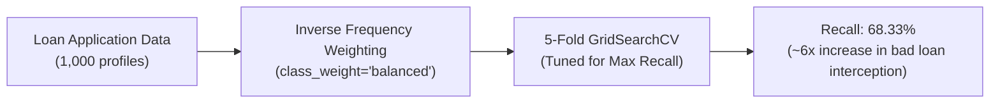

# Loan Default Risk Prediction Using Cost-Sensitive Decision Trees

[](https://www.python.org/)
[](https://scikit-learn.org/)
[](https://pandas.pydata.org/)
[](https://jupyter.org/)
[](LICENSE)

---

### The Problem It Solves
Standard credit scoring algorithms optimize for naive accuracy, creating dangerous blind spots where default-prone borrowers are mistakenly approved. A single defaulted loan costs banks far more than the profit from several performing loans. Unweighted models caught only ~11.7% of defaulters, leaving lenders vulnerable to heavy financial loss.

### How It Solves It
Applies cost-sensitive class balancing (`class_weight="balanced"`) to penalize default misclassifications and uses 5-fold `GridSearchCV` optimized specifically for **Recall** (`refit="recall"`), elevating defaulter detection from **11.67% to 68.33%**.

---

### Quick Summary: What It Has Done & What It Does
*(Fast overview for users who want the essential takeaways without reading the full report)*

- **What It Has Done**:
  - Trained on 1,000 credit applicant profiles from the German Credit Dataset.
  - Compared baseline unweighted trees against cost-weighted, hyperparameter-tuned trees.
  - Boosted defaulter recall by nearly **6x** (from 11.67% up to 68.33%), capturing the vast majority of high-risk applicants.
  - Visualized the resulting decision tree architecture to provide full credit-decision explainability for bank auditors.
- **What It Does**:
  - Scores loan applications using applicant checking balance, loan duration, credit history, and employment indicators.
  - Flags high-risk borrowers before loan disbursement, directly protecting commercial banking capital from bad debt.

---

## Performance Comparison: Baseline vs. Cost-Sensitive Tuned Tree

| Metric | Baseline Unweighted Tree | Cost-Sensitive Tuned Tree | Business Impact |
| :--- | :---: | :---: | :--- |
| **Defaulter Recall** | **11.67%** | **68.33%** | **Intercepted ~6x more defaulting loans** |
| **Overall Accuracy** | 71.50% | 66.50% | Controlled sacrifice of naive accuracy to protect capital |
| **Defaulters Caught** | 7 / 60 | **41 / 60** | **Saved 34 additional loans from default loss** |



---

## Quick Start

```bash
# Clone the repository
git clone https://github.com/Umair-Nawaz0/decision-tree-loan-default-risk-prediction.git
cd decision-tree-loan-default-risk-prediction

# Install dependencies
pip install pandas numpy scikit-learn jupyter
```

Both the executable notebook ([`decision_tree_loan_default_prediction.ipynb`](decision_tree_loan_default_prediction.ipynb)) and exported report ([`decision_tree_loan_default_prediction.pdf`](decision_tree_loan_default_prediction.pdf)) are available in the repository.

---

## Author

**Umair Nawaz**  
- GitHub: [@Umair-Nawaz0](https://github.com/Umair-Nawaz0)
